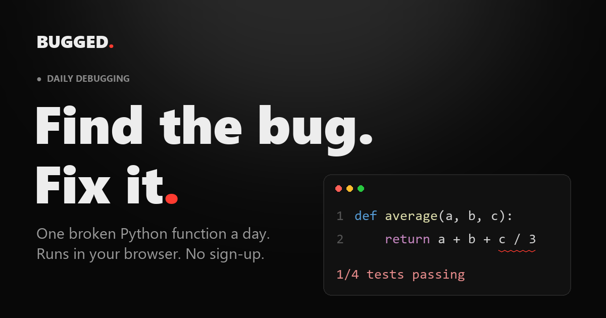
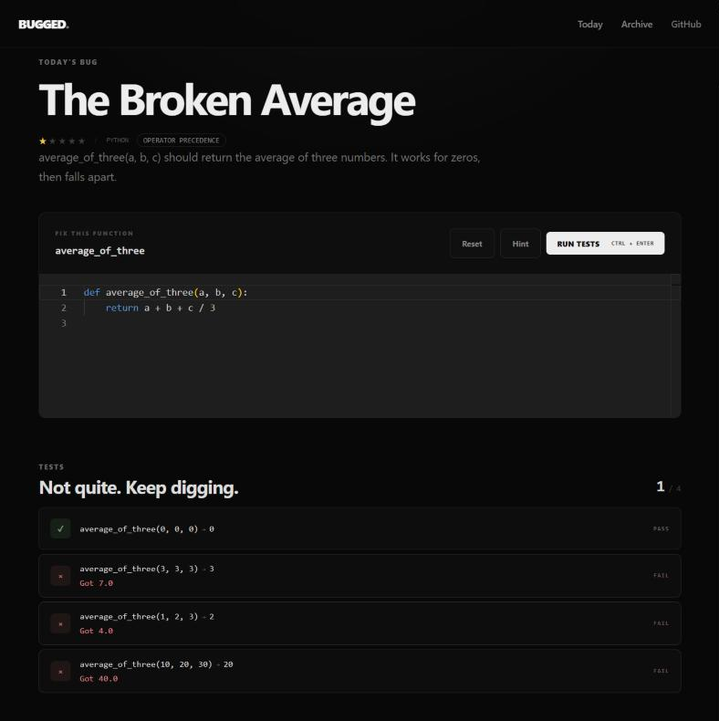
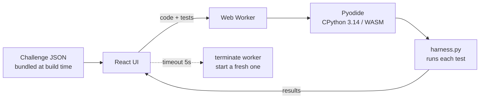

<p align="center">
  
</p>

<p align="center">
  <strong>One broken Python function a day. Find the bug, make the tests pass.</strong><br />
  Runs entirely in your browser. No sign-up, nothing to install.
</p>

<p align="center">
  <a href="https://cheikh-m97.github.io/bugged/"><strong>▶ Play today's bug</strong></a>
  ·
  <a href="#how-it-works">How it works</a>
  ·
  <a href="#add-a-challenge">Add a challenge</a>
</p>

<p align="center">
  <a href="https://github.com/CHEIKH-M97/bugged/actions/workflows/ci.yml"></a>
  
  
</p>

---

## Why

Most coding practice asks you to write code from a blank page. Real work is
mostly the opposite: you read code that *looks* right and figure out why it
isn't. Bugged trains that skill in five minutes a day.

Every bug is small, realistic and teaches one thing: operator precedence,
mutable default arguments, late-binding closures, floating-point money...



## Features

- **A new bug every day.** Same bug for everyone, switching at midnight UTC. Past bugs stay in the archive.
- **Real Python in the browser.** Your code runs in [Pyodide](https://pyodide.org) (CPython compiled to WebAssembly) inside a Web Worker.
- **Clear feedback.** Every test shows the call, the expected value, what you returned, the exception and line number, and anything you `print()`.
- **Hints and explanations.** Stuck? Take a hint. After solving (or giving up) you get an explanation of the bug and a reference solution.
- **Streaks and sharing.** Your streak is saved on your device. Share a spoiler-free result grid:
  ```
  Bugged #007 🐛 3 runs
  🟥🟩🟩🟥
  🟥🟩🟩🟩
  🟩🟩🟩🟩
  🔥 4-day streak
  ```
- **Infinite-loop safe.** Code that runs longer than 5 seconds is stopped and the page stays responsive.

## How it works



- **No backend.** The whole app is a static site on GitHub Pages. Challenges are JSON files bundled by Vite.
- **The worker is the sandbox.** Player code can't block the UI. An infinite loop is stopped by terminating the worker, which is the only reliable way to interrupt WebAssembly.
- **One harness, two places.** [`src/lib/harness.py`](src/lib/harness.py) runs in the browser *and* in CI. It executes the code in a fresh namespace, calls the entry function once per test, and compares return values structurally (floats with a tolerance, `True` never equal to `1`).
- **Every challenge is verified.** [`scripts/validate-challenges.mjs`](scripts/validate-challenges.mjs) runs each challenge in the same Pyodide build and fails CI unless the buggy code fails at least one test **and** the reference solution passes all of them.

### From Docker to WebAssembly

My first prototype was a FastAPI backend that ran every test in a locked-down Docker container (no network, read-only filesystem, dropped capabilities, memory/CPU/PID limits). It was secure, but it needed a server that allows Docker, rate limiting to survive the open internet, and a container cold start for every test.

Moving execution into the browser removed all three problems. Each player's code runs on their own machine, the hosting is free, and feedback is instant. The trade-off is that tests can't be secret, since anything in the browser is readable. For a learning tool with no leaderboard, that's acceptable, so all tests are visible.

## Tech stack

| | |
|---|---|
| UI | React 19, React Router 7, Monaco editor |
| Python runtime | Pyodide 314 (CPython 3.14 on WebAssembly) in a Web Worker |
| Build | Vite 8 |
| Tests | Vitest (logic + the harness running in real Pyodide) and a challenge validator |
| CI/CD | GitHub Actions → GitHub Pages |

## Quickstart

Requires Node 20+.

```bash
git clone https://github.com/CHEIKH-M97/bugged.git
cd bugged
npm install
npm run dev        # http://localhost:5173
```

| Command | What it does |
|---|---|
| `npm run dev` | Start the dev server |
| `npm test` | Unit tests |
| `npm run validate` | Check every challenge (bug is caught, solution passes) |
| `npm run build` | Production build into `dist/` |
| `npm run check` | All of the above, like CI |

## Add a challenge

Challenges live in [`challenges/`](challenges), one JSON file each. The `id` sets the release order (day 1 is id 1).

```json
{
  "id": 31,
  "title": "Short, Catchy Title",
  "difficulty": 2,
  "language": "python",
  "topics": ["what it teaches"],
  "description": "What the function should do, precisely enough to fix it.",
  "entry": "function_name",
  "code": "def function_name(x):\n    ...buggy...\n",
  "solution": "def function_name(x):\n    ...fixed...\n",
  "hint": "A nudge, not the answer.",
  "explanation": "What was wrong and the general lesson.",
  "tests": [
    { "args": [1], "expected": 2 }
  ]
}
```

Then run `npm run validate`. A good challenge:

- has **one** bug, in code that looks reasonable at first glance
- includes at least one test the buggy code **passes**, so the bug is hidden at first
- teaches something that transfers to real code, which goes in `explanation`

See [CONTRIBUTING.md](CONTRIBUTING.md) for more.

## Project structure

```
challenges/          one JSON file per bug
scripts/             challenge validator (runs in CI)
src/
  lib/
    harness.py       runs the tests (browser + CI)
    python.worker.js loads Pyodide, runs the harness
    runner.js        worker lifecycle and the 5 s timeout
    schedule.js      which bug is released on which day (UTC)
    progress.js      streaks and solved list (localStorage)
  pages/             Home, Archive, Challenge
  components/        Editor (Monaco), Difficulty, PageState
tests/               Vitest suites
```

## Roadmap

- [ ] JavaScript challenges (run natively in a worker)
- [ ] "Explain the bug" mode: pick the cause from multiple choices
- [ ] Difficulty-based weekly schedule (easy Monday → hard Friday)
- [ ] Offline support (cache Pyodide with a service worker)
- [ ] More challenges, ideally contributed by you

## Contributing

Bug reports, new challenges and fixes are welcome. Read [CONTRIBUTING.md](CONTRIBUTING.md) and open a pull request.

## License

[MIT](LICENSE)
